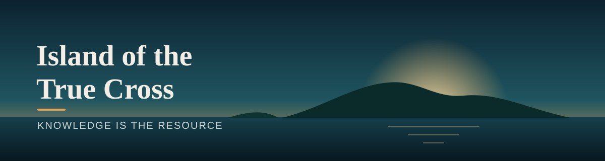

<div align="center">



### A co-op survival game where the most valuable resource is knowledge.

**In development · Unreal Engine 5 · 1–8 players**

</div>

---

## The game

Brazil, the early 1500s. The land is vast, and it is already occupied.

**Island of the True Cross** is a cooperative survival game set in the first years of the colonization of Brazil. A colonial company controls Tupi and Quilombola settlements. You play as one of them, and you fight to survive, free your people and build a community that can stand on its own.

The name comes from *Ilha de Vera Cruz*, the first name the Portuguese gave to Brazil.

## The story

**Before it was called Brazil, this land had other names.** Ilha de Vera Cruz. Terra dos Papagaios, the Land of Parrots. Pindorama.

In 1519, cartographers drew one of its first images: a coast covered in forest, people cutting brazilwood with its red heart, macaws in the sky and ships on the horizon. The map shows a rich land. It doesn't show what was beginning to happen there.

Island of the True Cross takes place inside that map.

The island had its people long before the ships. Now the Captaincy's soldiers and overseers control the villages, and those who lived there are held under the colonial company. But no one is simply waiting to be saved: the captives resist, hide information and wait for an opening.

You are born Tupi or Quilombola. This is not the story of those who arrived. It is the story of those who were already here, and of those who escaped and will never go back.

## The peoples

- **Tupi:** they know the land like no one else: the forest, the rivers and everything they give.
- **Quilombolas:** people who escaped slavery and built community and freedom with their own hands.
- **The colonial company:** the enemy is the machine of exploitation, not a people. Even within it, there are rare deserters who change sides.
- **The Ruins of Pindorama:** temples of a far older civilization, forgotten on the island. No one knows for sure what they hold.

## The forest has its own guardians

Brazilian folklore is alive on the island. Curupira, Iara, Boitatá, Caipora and Mapinguari aren't just monsters to defeat. They are forces of the world, with their own rules. Sometimes the way forward isn't strength, but what your people know about how to deal with them.

## What makes it different

Most survival games follow the same loop: gather, craft, climb a fixed tech tree.

Here, the path is different:

```text
explore  →  people  →  knowledge  →  evolution
```

- **Knowledge is the resource.** What you can build depends on who you meet and who chooses to teach you.
- **Liberation first.** The world begins under occupation. Freeing it is the heart of the game.
- **Trust is earned.** People join you by consent, not by purchase.
- **Cultures work together.** The strongest technologies only exist when different peoples share what they know.
- **Better together.** The game rewards planning, cooperation and specialization.

## How the game treats this history

Colonization and slavery are real, recent and painful history, and the game treats them seriously:

- Tupi and Quilombolas are protagonists, never enemies or scenery.
- No one is bought or captured by the player. Those who join you choose to.
- The blending of cultures is shown as a strength, as it was in the making of Brazil.

## Status

The game is in early development by a solo developer in Rio de Janeiro. Screenshots and video will be added here as the world takes shape.

> This repository is a showcase. The game itself is closed source, so you won't find any code or game files here.

---

<div align="center">

Made by [Janísio Jr.](https://github.com/smokejan)

</div>
